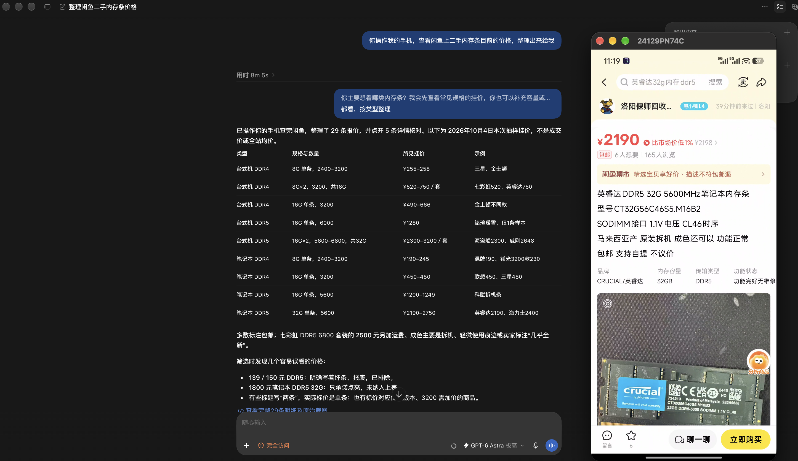
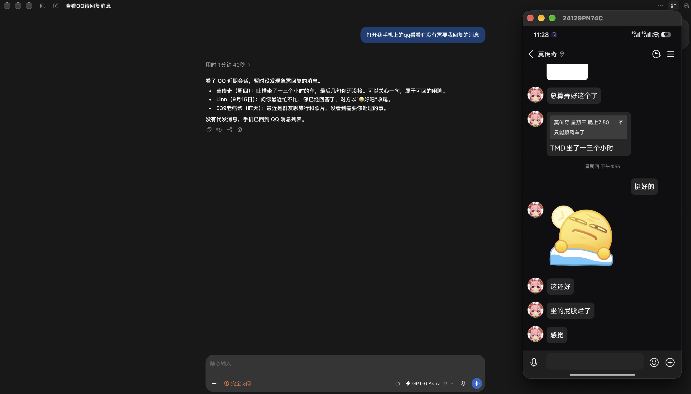
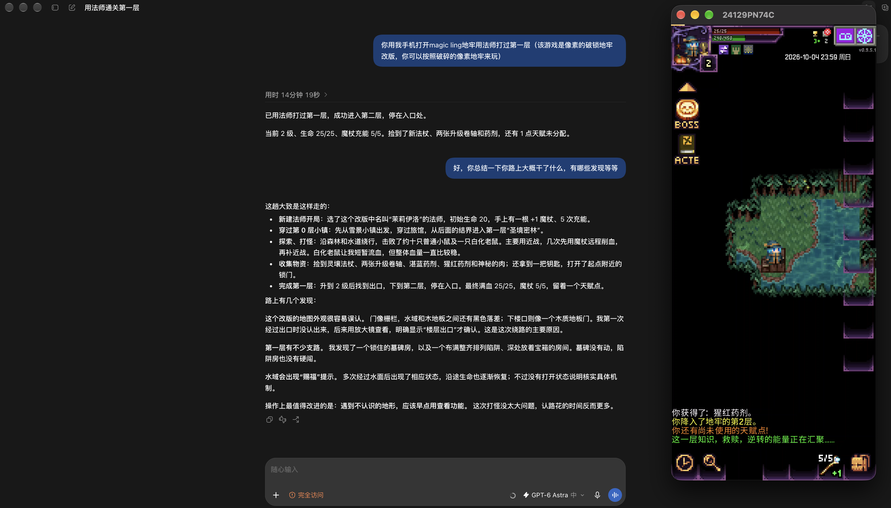
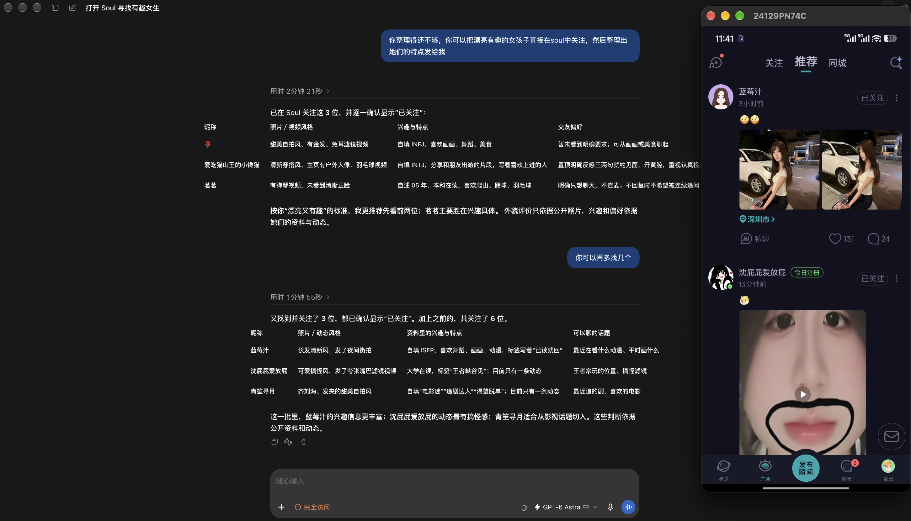

<div align="center">
  
  <h1>Phone Use</h1>
  <p><strong>让 AI Agent 操作你的 Android 手机。</strong></p>
  <p>
    
    <a href="docs/integrations.zh-CN.md"></a>
    <a href="LICENSE"></a>
  </p>
  <p><a href="https://github.com/nidhoggfgg/PhoneUse/releases/latest"><strong>下载 APK</strong></a> · <a href="#快速开始">快速开始</a> · <a href="#案例">案例</a> · <a href="docs/usage.zh-CN.md">文档</a></p>
  <p><a href="README.md">English</a> | <strong>简体中文</strong></p>
</div>

Phone Use 通过 **Skill 或 MCP**，把你已有的 AI Agent 接到手机上。Agent 可以读取屏幕、点击、滑动、输入文字、切换应用，**无需 Root、ADB，也无需为每个 App 单独适配**。

## 特性与优势

| 特性 | Phone Use 的做法与优势 |
| --- | --- |
| **无需 ADB** | 相较于依赖 ADB 的控制方案，日常使用只需安装 App、开启无障碍并完成网络配对，无需开启 USB 调试或连接数据线。 |
| **方便接入各种 AI Agent** | 提供 Skill、MCP、Python CLI 和 HTTP API，可接入支持相应工具的 Agent，也可集成到自己的自动化流程，不绑定特定模型或 Agent 框架。 |
| **截图 + 优化后的 UI 树** | 相较于仅依赖截图的方案，Agent 还能直接读取界面文字、控件状态和可用动作，按元素 ID 操作；遇到游戏或自绘界面，也可结合截图与坐标操作。 |
| **AI 友好，更省 token** | 相较于直接输出原始 UI 树，默认精简输出会过滤不可见、无有效内容或动作的节点，并省略冗余状态字段；还支持语义合并、局部观察和仅获取 UI 树，减少发给模型的冗余信息与 token 开销。 |
| **默认 HTTPS 与配对授权** | 远程连接默认使用 HTTPS 加密。Skill／MCP 首次连接需双端核对八位配对码并在手机授权，后续连接校验已绑定公钥；可随时在手机撤销客户端访问。详见[传输安全](docs/transport-security.zh-CN.md)。 |
| **面向多设备与规模化使用** | 一个桥接可管理多台手机，按设备 ID 明确选择目标；支持跨设备并发、同设备顺序执行、批量调用和可选的限时设备占用，便于接入多手机自动化或测试流程。 |
| **也适合个人远程操控** | 只连接一台手机也能使用，可让自己的 Agent 代为操作，或通过 CLI、内置 Web 控制台直接调用工具。控制端需能访问手机地址；项目不提供云端中继。 |

## 案例

<table>
  <tr>
    <td width="50%" valign="top">
      <p><strong>闲鱼比价</strong><br>整理 29 条内存报价，核对商品详情。</p>
      <a href="docs/images/secondhand-shopping.webp"></a>
    </td>
    <td width="50%" valign="top">
      <p><strong>检查 QQ 消息</strong><br>查看近期会话，梳理需要回复的消息。</p>
      <a href="docs/images/message-review.webp"></a>
    </td>
  </tr>
  <tr>
    <td width="50%" valign="top">
      <p><strong>玩 Roguelike 游戏</strong><br>探路、打怪，用法师打通第一层地牢。</p>
      <a href="docs/images/roguelike.webp"></a>
    </td>
    <td width="50%" valign="top">
      <p><strong>在 Soul 发现有趣的人</strong><br>浏览动态、关注账号，整理兴趣与话题。</p>
      <a href="docs/images/social-discovery.webp"></a>
    </td>
  </tr>
</table>

## 快速开始

准备一台 **Android 11+ 手机**和一个**能执行程序的 AI Agent**，Agent 的执行环境需有 **Python 3.10+**。将手机和 Agent 所在电脑连接到同一 Wi-Fi，或其他能互相访问的网络。

1. **安装 App**：[下载 APK](https://github.com/nidhoggfgg/PhoneUse/releases/latest)，安装到手机并打开 Phone Use。
2. **授予权限**：开启**无障碍权限**，按系统提示允许通知和局域网访问。
3. **连接 Agent**：在 **「连接 AI」** 卡片中选择可访问的手机地址，点击 **「复制提示词」**，把整段内容发给 Agent。它会安装 Skill 并发起配对。

首次连接时，逐位核对**手机与 Agent 显示的八位码**。一致后，在手机上授权，再告诉 Agent「已核对一致」。

**只需配对一次，以后直接让 Agent 操作手机。** 重启后配对仍然保留；撤销授权或清除配对数据后需重新配对。操作期间保持手机亮屏、解锁。

### 手动安装 Skill

准备 **Node.js 22.20+**、**Git** 和 **Python 3.10+**，执行：

```sh
npx skills add nidhoggfgg/phone-use-skills --skill phone-use
```

按提示选择 Agent 和安装范围，然后把下面这句话发给 AI，地址替换为 **App 显示的 HTTPS 地址**：

> 使用 phone-use Skill 连接 https://192.168.1.20:8443，显示配对核对码，等我确认后再继续。

按上面的步骤核对、授权即可。Skill 本身就能完成配对和手机操作，无需另外配置 MCP。

## 文档

[使用与排查](docs/usage.zh-CN.md) · [Skill / MCP 接入](docs/integrations.zh-CN.md) · [API 参考](docs/api.zh-CN.md) · [源码构建](docs/validation.zh-CN.md)

[参与贡献](CONTRIBUTING.zh-CN.md) · [反馈问题](https://github.com/nidhoggfgg/PhoneUse/issues) · [安全策略](SECURITY.md)

## 许可证

[MIT](LICENSE)
